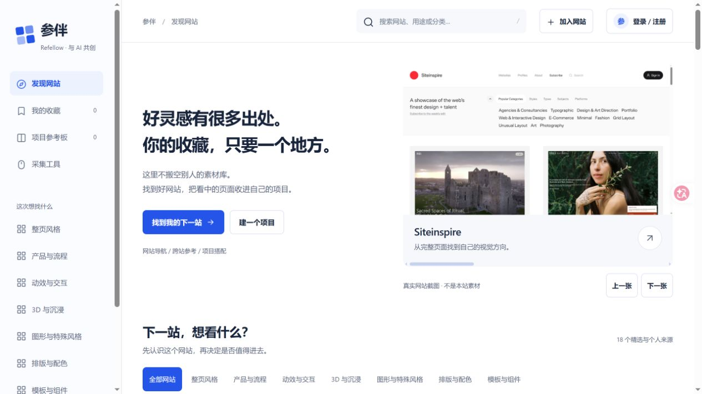

# Refellow · 参伴

把看中的网页画面和具体网址，收进自己的参考工作台。

[正式网站](https://refellow.pages.dev/) · [开发预览](https://preview.refellow.pages.dev/) · [下载采集器](https://github.com/ga626/refellow/releases/latest) · [反馈问题](https://github.com/ga626/refellow/issues)

免费使用，原创代码采用 [MIT](LICENSE) 许可。个人开发者 ga626；支持邮箱：18703937308@163.com。



## 可以做什么

- 浏览设计网站黄页，收藏具体页面，保留来源。
- 用可拖动、可收起的悬浮采集器框选截图，或录制当前标签页的局部／整个可见画面；手动停止，静音保存。
- 登录后把截图、录像存入个人云空间，在网站中查看、播放和整理；扩展自动识别网站账户，不需要连接码。
- 按项目分组，补充借鉴点、圈选、视频片段和文字资料，导出含实际媒体的参考 ZIP。
- 用邮箱验证码注册、邮箱和密码登录及找回；也保留账号注册和个人恢复密钥备用。

采集器在黄页收录的18个网站自动显示悬浮入口；其他普通网页点击扩展工具栏启用。首次采集须由用户授予当前页权限。只采集当前网页可见画面，不录音、不捕获桌面、不自动滚动；浏览器内部页面不支持采集。

## 开始使用

1. 打开正式网站，在右上角注册／登录，保存注册后一次展示的恢复密钥。
2. 安装页面采集器，回网站刷新一次，让扩展识别账户。商城审核状态见 [发布状态](docs/release-status.md)。
3. 在目标网页展开悬浮菜单，截图确认或录像停止后保存到个人空间；回网站的“我的收藏”查看。

手动安装包下载后先解压，在 `edge://extensions` 开启开发人员模式，选择“加载解压缩的扩展”，选包含 `manifest.json` 的文件夹。后续开发验收的固定目录与重新加载步骤见 [开发流程](docs/development-workflow.md)。

开发站与正式站账户、收藏和媒体分别保存。网站使用 Cloudflare Pages／D1，验证码邮件通过服务端邮件服务发送；用户电脑不需要为发邮件保持代理运行。免费首版每份媒体上限64 MiB、每个账户媒体128 MiB，达到容量会提示，不自动升级付费。旧版本地收藏可主动导出后导入，不自动上传。

## 本地开发

原生 JavaScript／CSS、ES modules，Node >=22.13，无第三方运行依赖，无需 `npm install`。网站、API与扩展在同一个仓库。

```sh
node scripts/build-collector.mjs
npm start
```

打开 `http://127.0.0.1:5192` 进行本机调试。云端部署须配置专用数据库及服务端秘密；缺失时明确报错，不冒充保存成功。

```sh
npm test
npm run build:pages
```

共享采集源码在 `public/collector/`；运行 `node scripts/sync-collector.mjs` 同步派生文件。日常在功能分支修改、检查、提交并更新开发站；只有明确启动 PR 收口后才推送、合并和更新正式站。正式部署提升 PR CI 已冻结、已验收的同一制品，完整步骤见 [开发流程](docs/development-workflow.md) 和 [部署入口](docs/pages-deployment.md)。

## 说明与支持

[账户与找回](docs/account-integration.md) · [云端配置](docs/cloud-deployment.md) · [隐私政策](https://refellow.pages.dev/privacy.html) · [安全问题](SECURITY.md) · [支持](SUPPORT.md)

截图和录像由用户主动采集，个人空间按账户隔离，不含广告跟踪或自动向 AI 发送内容。第三方网页、画面与品牌权利仍属于原权利人；开源许可不授予复制第三方作品的权利。自动检查、真实 Edge 验收和商城审核分别记录，最新交付结果以 [发布状态](docs/release-status.md) 为准。
